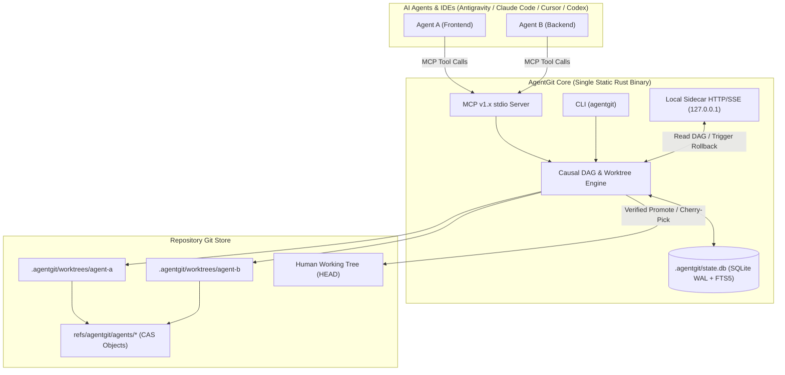

# DESIGN: AgentGit (`agentgit`) — Architectural Blueprint & MADR Log

**Version:** 1.0.0  
**Orchestrated Skills:** `rust-programming-expert`, `mcp-server-architect`, `database-orm-expert`, `senior-frontend`, `tailwind-expert`, `anti-slop`, `autonomous-tdd-debugger`  
**Design Read (R-37):** `"Reading this as: developer time-travel & causal DAG cockpit for multi-agent engineers, in a Linear/Vercel-inspired dark precision telemetry style, dial ENERGY 1 / RHYTHM 1 / MOTION 1"`

---

## 1. System Topology (Hybrid Shadow Worktree + Git Object Store)

---

## 2. Architectural Decision Records (MADR Standard)

| # | Decision Title | Status | Context & Problem | Chosen Solution & Rationale | Consequences & Trade-offs | Orchestrated Skill |
| :--- | :--- | :--- | :--- | :--- | :--- | :--- |
| 1 | **Git Worktree + CAS Refs vs Custom VFS** | Accepted | Copying full repos per agent is slow and wastes disk; FUSE/VFS is brittle on Windows. | Native `git worktree` + ephemeral `refs/agentgit/*` sharing `.git/objects`. | `<15ms` snapshot via Git tree OID; works natively on Windows/macOS/Linux; requires `.git` repo. | `rust-programming-expert` |
| 2 | **SQLite WAL + FTS5 for Causal DAG** | Accepted | Git commit messages alone cannot efficiently query prompt hashes, token costs, or gate runs. | Embedded `rusqlite` (bundled) in WAL mode + FTS5 full-text index. | Zero external DB daemon; `<5ms` queries; requires `busy_timeout` for parallel MCP calls. | `database-orm-expert` |
| 3 | **Single Static Rust Binary + NPM Wrapper** | Accepted | Users of `vibes-plug` and Cursor install via `npx` or `cargo`. | Compile Rust binary + thin `npm` postinstall/bin wrapper (`npx agentgit`). | `<10ms` CLI cold start; familiar NPM/Cargo distribution. | `ci-cd-devops-architect` |
| 4 | **Zero-Auth Localhost Sidecar with Ephemeral Token** | Accepted | Sidecar UI needs mutating endpoints (`/rollback`, `/promote`, `/purge`) without cloud login. | Bind strictly `127.0.0.1` + per-session CSPRNG CSRF/Bearer token injected at launch. | Zero cloud dependency; immune to external network access. | `zero-trust-secret-vault` |

---

## 3. Pre-Mortem Risk Assessment & Mitigation
1. **Windows File Locking (`EBUSY` / `Sharing Violation`) during Parallel Worktree Cleanup:**
   - *Mitigation:* Apply retry-with-backoff on worktree prune (learned from `xerj` Windows harness) and never hold open file handles across `spawn`/`gc`.
2. **Merge Conflicts When Promoting Multiple Parallel Agents:**
   - *Mitigation:* Run `git merge-tree --write-tree` dry-run pre-flight inside `agentgit promote` before touching human `HEAD`; surface exact conflicting hunks to the agent or Sidecar UI.
3. **Orphaned Worktrees & Disk Bloat:**
   - *Mitigation:* Track session TTL in `sessions` table and auto-run `agentgit gc --stale` on `spawn` if worktree count > 16.
4. **Silent Partial Failure in Multi-Agent Rollback:**
   - *Mitigation:* Wrap SQLite state mutation + Git ref update in a compensating transaction: update Git ref first, verify OID, then commit SQLite `is_rolled_back = 1`.

---

## 4. FinOps Cost Envelope (Local-First)
- **Runtime Cloud Cost:** **\$0.00 / month** (100% local execution; zero hosted database or inference proxy required).
- **Disk Overhead:** ~2–10 MB per active shadow worktree (shared `.git/objects` + sparse metadata in `.agentgit/state.db`).
- **Distribution Cost:** GitHub Releases (binary artifacts) + Crates.io + NPM Registry (free OSS tier).

---

## 5. Subagent Contract Map Slice (`CONTEXT_MAP.md` Seed)
- **Workspace Target:** `C:\Users\roedy\.gemini\antigravity\scratch\agentgit`
- **Core Crates:** `clap` (CLI), `rusqlite` (bundled WAL/FTS5), `serde`/`serde_json` (MCP JSON-RPC 2.0), `axum` or `tiny_http` (Sidecar HTTP/SSE), `uuid`/`ulid`, `sha2`.
- **Mandatory Routes (Sidecar UI):** `/`, `/privacy`, `/terms`, `/delete-account`, `/api/v1/dag`, `/api/v1/rollback`, `/api/v1/promote`, `/api/v1/purge`.
