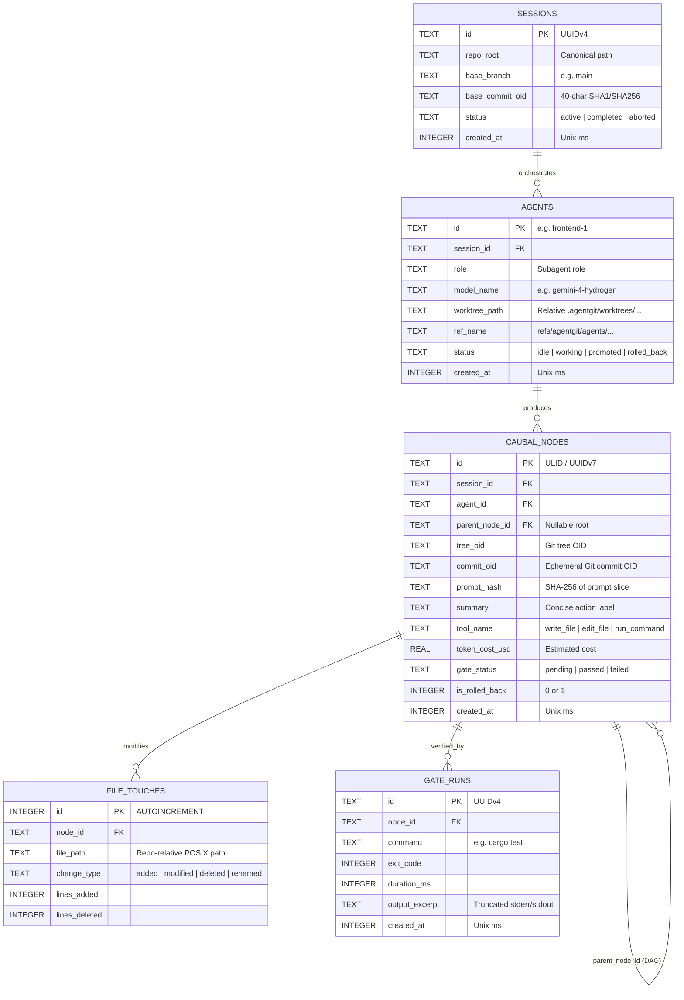

# ERD: AgentGit Causal State & Shadow Worktree Schema

**Database Engine:** Embedded SQLite 3 (WAL Mode, `foreign_keys = ON`, FTS5 enabled)  
**Location:** `<repo_root>/.agentgit/state.db`  

---

## 1. Entity Relationship Diagram



---

## 2. Production SQLite DDL

```sql
PRAGMA journal_mode = WAL;
PRAGMA synchronous = NORMAL;
PRAGMA foreign_keys = ON;
PRAGMA busy_timeout = 5000;

CREATE TABLE IF NOT EXISTS sessions (
    id TEXT PRIMARY KEY,
    repo_root TEXT NOT NULL,
    base_branch TEXT NOT NULL,
    base_commit_oid TEXT NOT NULL,
    status TEXT NOT NULL CHECK (status IN ('active', 'completed', 'aborted')) DEFAULT 'active',
    created_at INTEGER NOT NULL
);

CREATE TABLE IF NOT EXISTS agents (
    id TEXT PRIMARY KEY,
    session_id TEXT NOT NULL REFERENCES sessions(id) ON DELETE CASCADE,
    role TEXT NOT NULL,
    model_name TEXT,
    worktree_path TEXT NOT NULL,
    ref_name TEXT NOT NULL,
    status TEXT NOT NULL CHECK (status IN ('idle', 'working', 'promoted', 'rolled_back')) DEFAULT 'idle',
    created_at INTEGER NOT NULL
);

CREATE TABLE IF NOT EXISTS causal_nodes (
    id TEXT PRIMARY KEY,
    session_id TEXT NOT NULL REFERENCES sessions(id) ON DELETE CASCADE,
    agent_id TEXT NOT NULL REFERENCES agents(id) ON DELETE CASCADE,
    parent_node_id TEXT REFERENCES causal_nodes(id) ON DELETE SET NULL,
    tree_oid TEXT NOT NULL,
    commit_oid TEXT NOT NULL,
    prompt_hash TEXT NOT NULL,
    summary TEXT NOT NULL,
    tool_name TEXT NOT NULL,
    token_cost_usd REAL NOT NULL DEFAULT 0.0,
    gate_status TEXT NOT NULL CHECK (gate_status IN ('pending', 'passed', 'failed')) DEFAULT 'pending',
    is_rolled_back INTEGER NOT NULL CHECK (is_rolled_back IN (0, 1)) DEFAULT 0,
    created_at INTEGER NOT NULL
);

CREATE TABLE IF NOT EXISTS file_touches (
    id INTEGER PRIMARY KEY AUTOINCREMENT,
    node_id TEXT NOT NULL REFERENCES causal_nodes(id) ON DELETE CASCADE,
    file_path TEXT NOT NULL,
    change_type TEXT NOT NULL CHECK (change_type IN ('added', 'modified', 'deleted', 'renamed')),
    lines_added INTEGER NOT NULL DEFAULT 0,
    lines_deleted INTEGER NOT NULL DEFAULT 0
);

CREATE TABLE IF NOT EXISTS gate_runs (
    id TEXT PRIMARY KEY,
    node_id TEXT NOT NULL REFERENCES causal_nodes(id) ON DELETE CASCADE,
    command TEXT NOT NULL,
    exit_code INTEGER NOT NULL,
    duration_ms INTEGER NOT NULL,
    output_excerpt TEXT NOT NULL,
    created_at INTEGER NOT NULL
);

-- B-Tree Indexes for all Foreign Keys & Hot Queries
CREATE INDEX IF NOT EXISTS idx_agents_session ON agents(session_id);
CREATE INDEX IF NOT EXISTS idx_nodes_session ON causal_nodes(session_id, created_at DESC);
CREATE INDEX IF NOT EXISTS idx_nodes_agent ON causal_nodes(agent_id, created_at DESC);
CREATE INDEX IF NOT EXISTS idx_nodes_parent ON causal_nodes(parent_node_id);
CREATE INDEX IF NOT EXISTS idx_touches_node ON file_touches(node_id);
CREATE INDEX IF NOT EXISTS idx_touches_path ON file_touches(file_path);
CREATE INDEX IF NOT EXISTS idx_gates_node ON gate_runs(node_id);

-- FTS5 Virtual Table for Instant Causal Search (Prompt/Summary/File)
CREATE VIRTUAL TABLE IF NOT EXISTS causal_fts USING fts5(
    node_id UNINDEXED,
    agent_id,
    summary,
    tool_name,
    tokenize = 'porter unicode61'
);
```
