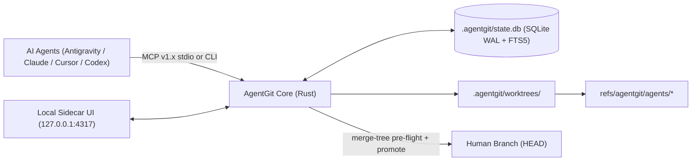

# AgentGit (`agentgit`)

[](https://github.com/roedyrustam/agentgit/actions/workflows/ci.yml)
[](LICENSE)
[](https://www.rust-lang.org/)
[](https://modelcontextprotocol.io/)

**Local-First Causal Time-Travel & Shadow Worktree Engine for Multi-Agent AI**  
*Single static Rust binary · Git Shadow Worktrees · Embedded SQLite WAL/FTS5 · MCP v1.x · Local Sidecar Cockpit*

---

## Why AgentGit?

When multiple AI coding agents (Antigravity, Claude Code, Cursor, Codex, or custom MCP swarms) edit a repository concurrently, standard `git` workflows break down:

- **Working-tree collisions:** Parallel agents overwrite each other's uncommitted changes.
- **Lost causal context:** `git stash` and raw commits don't track *which* prompt, tool call, or token budget produced a diff.
- **Coarse rollbacks:** Reverting one hallucinated agent turn risks wiping valid edits from other agents.

**AgentGit** isolates each agent in an ephemeral Git shadow worktree (`refs/agentgit/agents/<id>`), records every **Prompt -> Tool Call -> File Diff -> Gate Verdict** in embedded SQLite (WAL + FTS5), and lets you surgically roll back or quality-gate promote work without touching human `HEAD`.

---

## Architecture



---

## Key Features

- **Zero-Pollution Shadow Worktrees (`agentgit spawn`):** Parallel agents write to isolated `.agentgit/worktrees/<id>` directories sharing `.git/objects` without polluting `refs/heads/*` or `git status`.
- **Atomic Checkpoints (`agentgit checkpoint`):** Captures snapshots via an isolated `GIT_INDEX_FILE` without mutating human staging or branches.
- **Causal DAG & FTS5 Search (`agentgit log`):** Query causal history by agent, prompt summary, or tool name.
- **Surgical Causal Rollback (`agentgit rollback`):** Reverts a target causal node and its descendants while leaving orthogonal agent branches intact.
- **Quality-Gated Promote (`agentgit verify` & `agentgit promote`):** Executes tests/linters inside the shadow worktree and runs `git merge-tree --write-tree` conflict pre-flight before touching `HEAD`.
- **Native MCP v1.x Server (`agentgit mcp`):** Exposes `agentgit_spawn_shadow`, `agentgit_checkpoint`, `agentgit_causal_log`, `agentgit_diff_node`, `agentgit_rollback_causal`, and `agentgit_verify_and_promote` over `stdio`.
- **Local Sidecar Cockpit (`agentgit ui`):** Precision dark telemetry UI bound strictly to `127.0.0.1:4317` with ephemeral `X-AgentGit-Token` protection and built-in `/privacy`, `/terms`, and `/delete-account` routes.

---

## Installation & Build

```bash
git clone https://github.com/roedyrustam/agentgit.git
cd agentgit
cargo build --release
```

The compiled binary will be available at `target/release/agentgit` (or `target\release\agentgit.exe` on Windows).

---

## Quick Start

```bash
# 1. Initialize AgentGit in any Git repository
agentgit init

# 2. Spawn isolated shadow worktrees for parallel agents
agentgit spawn --agent frontend-1 --role "UI Engineer"
agentgit spawn --agent backend-1 --role "API Engineer"

# 3. Capture causal checkpoints inside an agent's shadow worktree
agentgit checkpoint --agent frontend-1 --tool write_file --summary "Add login form" --prompt "Build login"

# 4. Inspect causal DAG & full-text search
agentgit log --limit 20
agentgit log --search "login"

# 5. Inspect diff for a causal node
agentgit diff <NODE_ID>

# 6. Verify with tests/linters inside the shadow worktree
agentgit verify --agent frontend-1 --cmd "cargo test"

# 7. Surgical rollback (leaves other agents intact)
agentgit rollback --node <NODE_ID>

# 8. Promote verified changes to human HEAD (with conflict pre-flight)
agentgit promote --agent frontend-1 --squash

# 9. Clean up promoted or rolled-back worktrees
agentgit gc
```

---

## MCP v1.x Integration

Add `agentgit` to your IDE or agent orchestrator's MCP configuration (`mcp_config.json`, `.cursor/mcp.json`, or `.claude.json`):

```json
{
  "mcpServers": {
    "agentgit": {
      "command": "agentgit",
      "args": ["mcp"]
    }
  }
}
```

---

## Local Sidecar UI & Privacy Compliance

Launch the local telemetry cockpit:

```bash
agentgit ui --port 4317
```

- **100% Local-First:** All state, diffs, and SQLite records remain on `127.0.0.1` with zero external telemetry.
- **Built-in Legal & Privacy Routes:**
  - `/privacy` — Local-first privacy policy (UU PDP No. 27/2022 & GDPR Art. 13)
  - `/terms` — Usage terms & liability boundaries
  - `/delete-account` — Permanent local `.agentgit/` data purge (`POST /api/v1/purge`)

---

## Testing & Verification

```bash
cargo fmt --all -- --check
cargo clippy --all-targets -- -D warnings
cargo test
```

---

## Documentation

- [PRD.md](PRD.md) — Product Requirements & Non-Functional Budgets
- [DESIGN.md](DESIGN.md) — Architecture Blueprint & MADR Log
- [ERD.md](ERD.md) — SQLite WAL + FTS5 Schema & Entity Relationship Diagram
- [DOCUMENTATION.md](DOCUMENTATION.md) — Quick Reference

## License

Licensed under the [MIT License](LICENSE).
